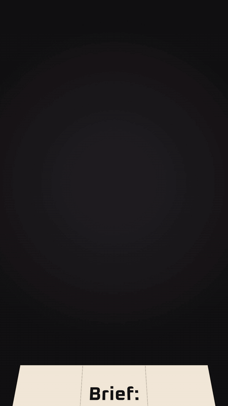

# FrameMotion

Motion graphics from code for **Claude, Codex and ChatGPT Work**, maintained by FrameCore Works. FrameMotion turns an idea into a storyboard, builds the film in code (HyperFrames, canvas, GSAP or Remotion), renders the MP4 and checks it frame by frame, with designed sound when wanted.

**Current plugin version: 0.1.0.** FrameMotion is the former Motion Graphics module of [FrameCore Works Creative Studio](https://github.com/FrameCoreWorks/framecore-works-creative-studio), moved into its own plugin. It works on its own, with a short brief of its own, and as Studio's motion companion: then Studio keeps the brief, idea, copy locks, board approval and delivery, and FrameMotion does the motion plan, build, render and frame QA. Both talk through the shared `framecore-task-result/1` contract also used by Toolbox and Open Assets.

## Watch it

From a chat to a finished reel: a client asks for a motion reel, the creator asks about the mood, and the reel plays out of its bubble.

| From a brief to a film | Vertical reel | Data and a name title |
|---|---|---|
|  |  |  |
| A note becomes a storyboard, and the storyboard becomes the ad. | A brief on paper folds into a box and unfolds into the logo. | The tallest bar of a chart becomes the owner's name title. |

All of these were made with the motion route that is now FrameMotion, when it was still Creative Studio's Motion Graphics module ([how they were made](assets/demo/README.md)).

## Start here

- [Installation](INSTALL.md) for Claude Code, the Claude apps, Codex and ChatGPT Work
- [The skill](plugins/framemotion/skills/framemotion/SKILL.md) and its [motion workshop and decision table](plugins/framemotion/skills/framemotion/references/workshop/README.md)
- [Plugin changelog](plugins/framemotion/CHANGELOG.md)
- [Development rules](AGENTS.md) and the latest [handover](docs/handover-2026-11-12.md)

## What it needs

No account and no API key. Without code execution FrameMotion writes the storyboard and a motion contract you can watch and export in the [motion player](https://framecoreworks.github.io/framecore-works-creative-studio/). With Python 3.10+, Pillow and FFmpeg it renders through its Python renderer. With a shell, Node.js 20+, FFmpeg and Chrome or Chromium it builds HyperFrames, canvas, GSAP and Remotion compositions; pinned npm packages are installed only after you agree. Remotion is paid for companies above three people, and FrameMotion says so before choosing it.

## Licence

Apache-2.0. Bundled third-party engines, fonts and adapted material keep their own licences (MIT, Apache-2.0, OFL); see [NOTICE](plugins/framemotion/NOTICE).
